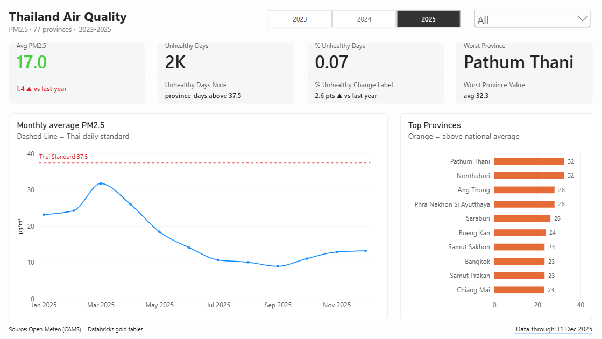
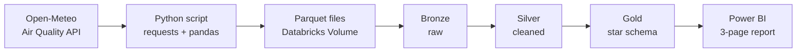
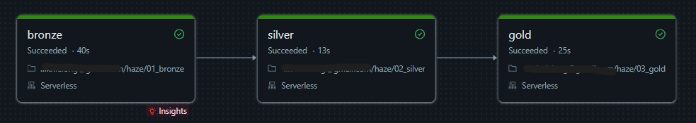
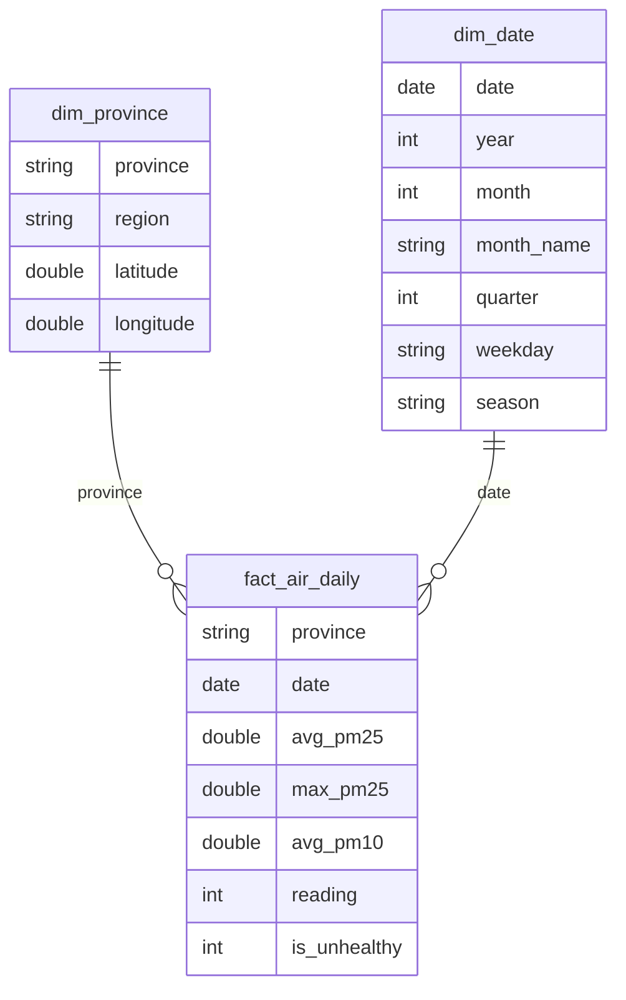
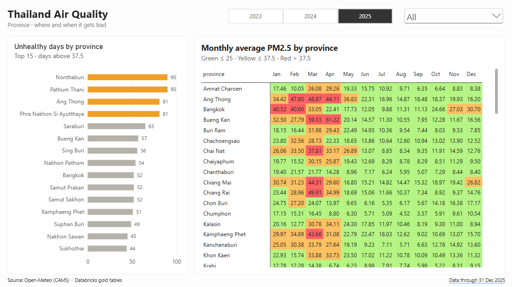
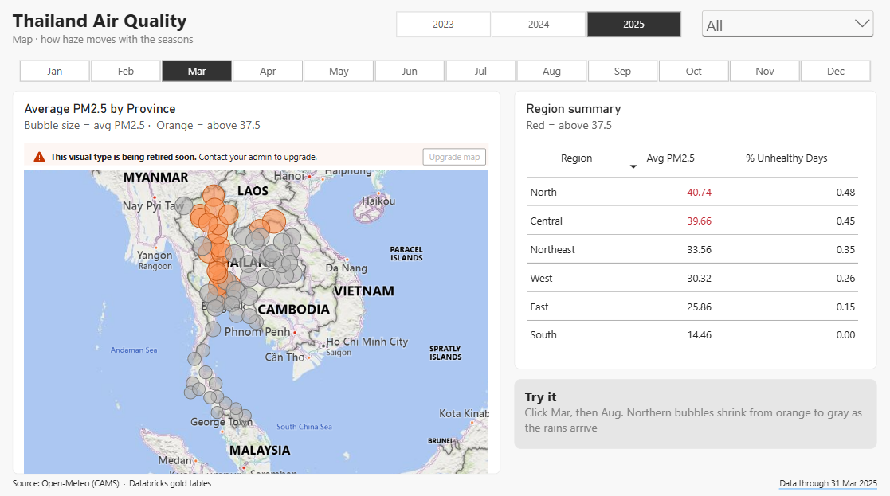

# Thailand Air Quality Data Pipeline
 
An end-to-end data pipeline that collects hourly PM2.5 data for all 77 Thai provinces (2023–2025), cleans and models it on Databricks, and presents it in a three-page Power BI report.
 

 
## The question
 
Every dry season, haze covers large parts of Thailand. This project answers three questions:
 
1. **How bad is it overall, and is it improving?**
2. **Which provinces are worst, and in which months?**
3. **Where in the country is the haze, and how does it move with the seasons?**
## Architecture
 

 
| Layer | Table | What happens |
|---|---|---|
| Raw | `/Volumes/workspace/haze/raw/` | 77 Parquet files (one per province) + a province reference file |
| Bronze | `bronze_air`, `bronze_provinces` | Files loaded as Delta tables, unchanged; `bronze_air` also gets an `ingested_at` timestamp |
| Silver | `silver_air` | Timestamps parsed, duplicates removed (`ROW_NUMBER` over province + time), readings outside 0–500 µg/m³ dropped, `CHECK` constraint added |
| Gold | `fact_air_daily`, `dim_date`, `dim_province`, `gold_monthly_rank` | Daily averages per province, a date dimension, and monthly province rankings (`RANK()` window function) |
 
The bronze → silver → gold notebooks run in order as a **Databricks Job** (about 1.5 minutes end to end).
 

 
## Data model
 

 
A day counts as **unhealthy** when its average PM2.5 is above **37.5 µg/m³**, Thailand's daily standard.
 
## Data quality
 
| Check | Result |
|---|---|
| Rows in bronze | 2,025,408 (77 provinces × 1,096 days × 24 hours, as expected) |
| Missing PM2.5 values | 0 |
| Readings outside 0–500 µg/m³ | 2 |
| Duplicate province + time rows | 0 |
| Rows in silver | 2,025,406 |
 
`silver_rows = bronze_rows − missing − out of range − duplicates` was used as a check that the cleaning logic is correct. Full details in [docs/data_quality.md](docs/data_quality.md).
 
## Power BI report
 
| Page | Answers | Visuals |
|---|---|---|
| **Overview** | How bad is it, and is it improving? | KPI cards with year-over-year comparison, monthly trend with the 37.5 standard line, top provinces |
| **Provinces** | Which provinces and which months? | Unhealthy days ranking, province × month heatmap |
| **Map** | Where is the haze, and how does it move? | Bubble map with month slicer, region summary table |
 
Year and region slicers are synced across all pages. Colour carries meaning only: orange marks what to look at, red marks values above the standard, everything else is grey or blue.
 
DAX used includes time intelligence (`SAMEPERIODLASTYEAR`) for year-over-year cards, `TOPN` to find the worst province under the current filters, `RANKX` to highlight the top 3 provinces, and `ALL` to compare each province with the national average.
 
| Provinces | Map |
|---|---|
|  |  |
 
## Key findings
 
- **Haze is seasonal and predictable.** The national monthly average peaks every February–March and falls to its lowest in June–August, when the rains start.
- **2024 was a milder year.** The national peak in 2024 was clearly lower than in 2023 and 2025.
- **It is not only a northern problem.** In March 2025 the Central region averaged 39.7 µg/m³, almost the same as the North (40.7). Both were above the national standard on nearly half of all province-days that month.
- **The Bangkok area is affected for a long part of the year.** In 2025, Nonthaburi and Pathum Thani each had 90 days above the standard, about one day in four.
- **National averages hide local problems.** The national monthly average never crossed 37.5, even in peak months, because cleaner provinces pull it down. This is why the report shows the share of unhealthy days and lets you filter by region.
## Limitations
 
- **Modelled data, not sensor readings.** Open-Meteo's air quality data comes from the CAMS atmospheric model on a grid of roughly 40 km. It smooths local peaks, so absolute values are lower than readings from Thailand's Pollution Control Department ground stations. Seasonal patterns and province rankings are the reliable part.
- **Extraction runs outside Databricks.** Databricks Free Edition restricts outbound internet access, so the API is called from a local Python script and the files are uploaded to a Volume. In production, extraction would be the first task in the Databricks Job.
- **Map visual.** Azure Maps is disabled in my organisation's Power BI tenant, so the Map page uses the classic Bing-based Map visual, which Microsoft is retiring.
## Tech stack
 
Python (requests, pandas, pyarrow) · Databricks (Free Edition, serverless) · Spark SQL · Delta Lake · Unity Catalog Volumes · Databricks Jobs · Power BI Desktop (DAX, star schema) · Git
 
## How to run
 
1. **Extract**
```bash
python -m venv .venv
.venv\Scripts\activate          # Mac/Linux: source .venv/bin/activate
pip install -r requirements.txt
cd extract
python fetch_air_quality.py
```
   This creates `extract/air/` (77 Parquet files) and `extract/province/` (1 file).
2. **Load** – In Databricks, create the schema and volume (`databricks/00_setup.sql`), then upload the files to `/Volumes/workspace/haze/raw/air/` and `/Volumes/workspace/haze/raw/province/`.
```sql
CREATE SCHEMA IF NOT EXISTS workspace.haze;
CREATE VOLUME IF NOT EXISTS workspace.haze.raw;
```
3. **Transform** – Run `databricks/01_bronze.sql`, `02_silver.sql` and `03_gold.sql` in order, or create a Job with three tasks.
4. **Report** – Open `powerbi/thailand_air_quality.pbix`, update the Databricks connection (SQL Warehouse server hostname and HTTP path) and refresh.
## Project structure
 
```
thailand-air-quality/
├── extract/fetch_air_quality.py
├── databricks/00_setup.sql, 01_bronze.sql, 02_silver.sql, 03_gold.sql
├── powerbi/thailand_air_quality.pbix
├── images/
├── docs/data_quality.md
├── requirements.txt
└── README.md
```
 
## What I learned
 
- Checking row counts before and after every step catches bugs that never raise an error. A wrong `PARTITION BY` once turned two million rows into 77, and only the count showed it.
- A bronze layer that is never modified makes it safe to fix and rerun the cleaning logic.
- Knowing the limits of a data source (modelled vs. measured) matters as much as the pipeline itself.
## Data sources and credits
 
- Air quality data: [Open-Meteo Air Quality API](https://open-meteo.com/en/docs/air-quality-api) (CC BY 4.0). Contains modified Copernicus Atmosphere Monitoring Service information.
## Author
Sszky
2026